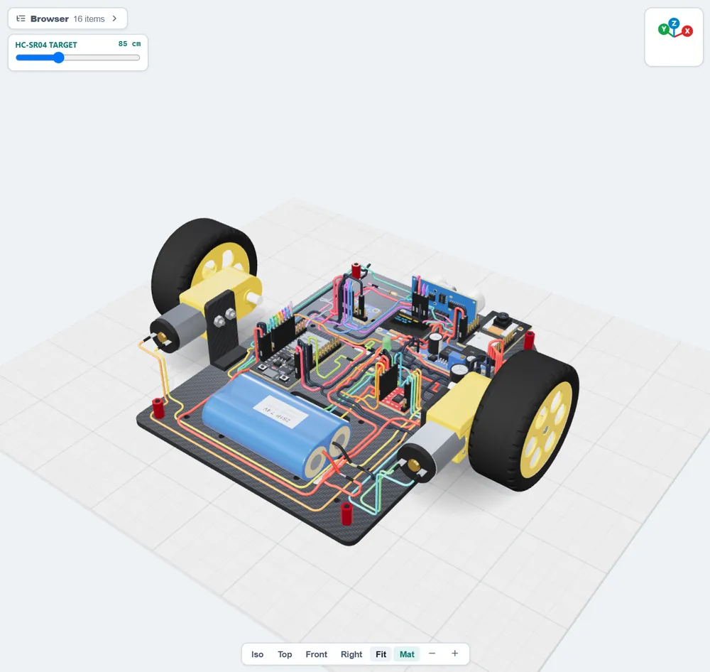
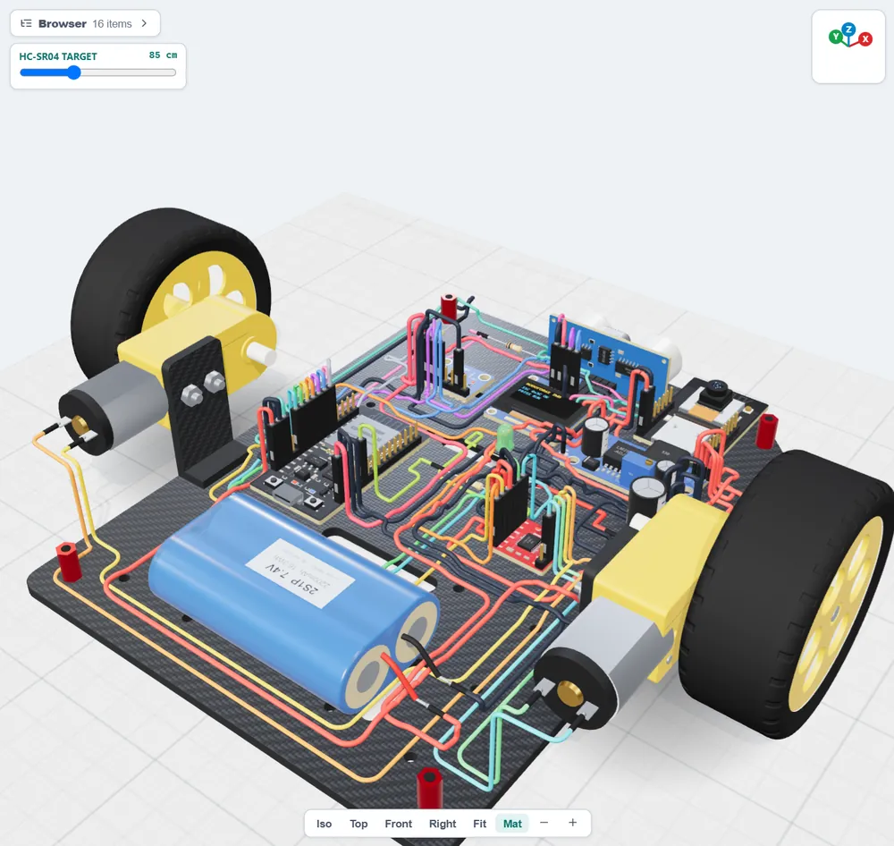
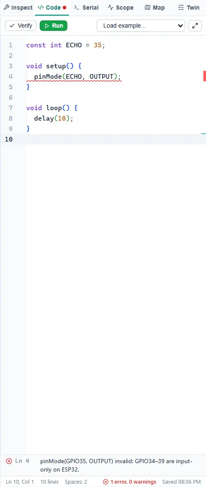
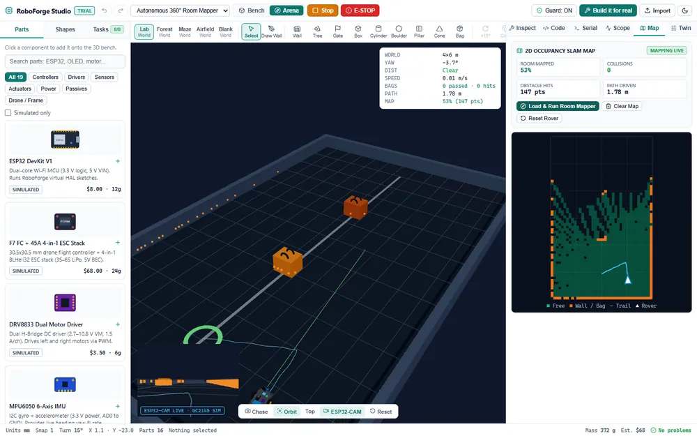
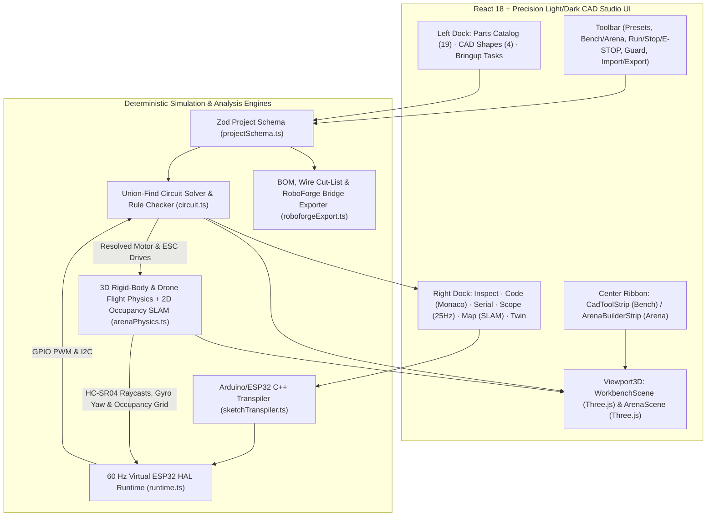

# RoboForge Studio

**RoboForge Studio** is a browser-based 3D bench for small robots and drones: real-size electronics parts you wire
pin to pin, an electrical rule and fault checker, an Arduino/ESP32 C++ editor that runs your sketch on a virtual
ESP32 (60 Hz HAL), a 4-channel scope, a 2D occupancy mapper, and a 3D physics arena (`cannon-es` + `Three.js`).

Everything runs locally in the browser; nothing needs a server or an account.

---

## Visual Preview

| 3D Electronics Workbench (2WD Rover) | Close-Up: real headers, modules and dressed wiring |
| :---: | :---: |
|  |  |

| 5" Freestyle Quadcopter Workbench | Pine Forest 3D Drone Space & FPV Camera |
| :---: | :---: |
|  |  |

### Parts modelled from datasheets

Every part is built at its real size from datasheet drawings and photos: the 30-pin ESP32 DevKit V1 with its
ESP-WROOM-32, CP2102 and AMS1117; the red HW-627 DRV8833; the GY-521, HC-SR04, SSD1306 OLED, 16x2 and 20x4
character LCDs with the PCF8574 I2C backpack, and the AI-Thinker ESP32-CAM; a TT gearmotor on a 65 mm wheel; a 2207 motor with a lofted 5" tri-blade; an FPV stack, an LM2596
buck, LiPo and Li-ion packs, and the passives. Headers sit at 2.54 mm and a wire's DuPont socket lands on the pin
that is drawn; leads and pads get soldered joints. Dimensions, pin orders and sources are listed in
[docs/06_COMPONENT_REFERENCES.md](docs/06_COMPONENT_REFERENCES.md), including what is simplified.

The library also has 35 more parts: SG90 and MG996R servos, a 28BYJ-48
stepper on its ULN2003 board, an N20 gearmotor, L298N, TB6612FNG and A4988 drivers, Arduino Nano and Raspberry Pi
Pico, DHT22, BME280, VL53L0X, HC-SR501 PIR, TCRT5000, NEO-6M GPS and DS3231 clock, a WS2812B stick, TM1637 and
MAX7219 displays, a joystick and a pot, HC-05, nRF24L01+ and microSD modules, MT3608, TP4056 and AMS1117 power
boards, a 4 x AA holder, a rocker switch, and loose diodes, transistors and capacitors. The circuit check uses their
real voltage ratings (for example 5 V on the BME280 or the nRF24L01+ is flagged). The servos, the buzzer, the relay
and the DHT22 also run in the simulator: sketches use the real `ESP32Servo` and `DHT` libraries and `tone()`, the horn
turns, the buzzer sounds, the relay switches an LED, and you set the air the DHT22 measures on the bench (see the
Actuator Lab preset). The others are wiring only for now. The full equipment list with what is in, what was added
and what is planned is [docs/07_PARTS_LIBRARY.md](docs/07_PARTS_LIBRARY.md).

### Sketch editor



- **Checks as you type**: missing `;`, undeclared names (with "did you mean"), unsupported C++ and calls the
  simulator does not model are underlined on the exact line and listed under Problems (click to jump).
- **Runtime faults point at the line** that caused them (for example `pinMode(35, OUTPUT)` on an input-only pin).
- **A runaway loop cannot freeze the page**: every loop form is guarded, and a loop that runs 8 s without
  `delay()` is stopped with a message naming its line.
- **C++ behaviour sketches rely on**: integer variables truncate and wrap, uninitialised variables start at zero,
  enums, `String` helpers, `sizeof(a)/sizeof(a[0])`, `Serial.print(x, HEX)`.
- **Autocomplete, hover help and parameter hints** for the virtual ESP32 API, light/dark themes, a wide mode.
- **Your work is kept**: the build and sketch are saved in this browser and restored on reload; loading an example
  or a preset asks first, and an example load can be undone with Ctrl+Z.

| Shortcut | Action |
| --- | --- |
| Ctrl+S | Verify the sketch and save |
| Ctrl+Enter | Run on the virtual ESP32 |
| Esc (in the editor) | Stop the sketch |
| F8 / Shift+F8 | Next / previous problem |

<br clear="right" />

### Design with AI

Open the **Design** tab and say what you want to build ("a rover that avoids walls and shows the distance on a
screen", or "you pick"). The AI asks at most a question or two, then a blueprint appears: a top view, the parts list
with costs and why each part is there, power and runtime, and the pin map. Press **Build on the bench** to watch it
assemble part by part and wire by wire. It comes with a starter sketch for the chosen pins, and you can export the
parts list as Markdown or CSV.

The AI only chooses the platform and the parts. Layout, pins, wiring, resistors, splices and the sketch are worked out
by rules, so every build follows the circuit checks (one jumper per pin, ECHO dividers, LED resistors). The AI runs
through the dev server with the key from `config/llm.json` (never sent to the browser). Without a key, a built-in
planner answers.

### Displays you program like the real ones

The OLED and the LCDs show what the sketch draws, using the same libraries as on the board, so the code can be
uploaded unchanged:

- **0.96" SSD1306 OLED** with `Adafruit_SSD1306` / `Adafruit_GFX`: pixels, lines, rectangles, circles, rounded
  rectangles, triangles, bitmaps (image2cpp and XBM), the built-in 6x8 font with text size, wrap, colours and
  rotation, invert, dim and hardware scroll. Nothing appears until `display.display()`, as on the real module.
- **16x2 and 20x4 LCDs** with `LiquidCrystal_I2C`: `init`, `backlight`, `setCursor`, `print`, custom characters
  (`createChar`, `B01010` constants), cursor, blink, scrolling. The character ROM, row order and backlight behave
  like the HD44780: text past the end of row 0 of a 20x4 continues on row 2, `(char)223` is the degree sign.
- **The I2C bus is real**: `Wire.begin(sda, scl)` picks the pins (default 21/22), the OLED answers at 0x3C and the
  LCD at 0x27, and an I2C scanner sketch finds what is wired. A wrong address, swapped SDA/SCL or a missing
  `display()` leaves the screen dark, and the Serial tab says why.
- Try the **Display Lab** preset (ESP32 + OLED + 16x2 LCD) or the *Rover OLED Dashboard* and *I2C Scanner* examples.
  The simple `oled.println()` shortcut still works for quick text.

Not modelled: U8g2 and other display libraries, SPI displays, the parallel `LiquidCrystal` wiring, custom GFX font
files (they are drawn with the built-in font scaled to about their size), and changing the modules' address jumpers.

| Interactive 3D Custom Arena Builder | Autonomous 360° Zero-Collision Room Mapper |
| :---: | :---: |
|  |  |

---

## Documentation Index (`docs/`)

All documentation is organized in order inside [`docs/`](docs/):

1. **[01 — Competitive Research & Gap Analysis](docs/01_RESEARCH_AND_GAP_ANALYSIS.md)**
   - Deep-dive breakdown of **Constructa (AtumX)** and **BenchTwin**, feature comparison matrix against RoboForge, what we adopted, and what RoboForge uniquely brings (Reality-Gap motor/gyro/friction physics, SLAM mapping, and hardware bridge export).
2. **[02 — System Architecture & Implementation Guide](docs/02_ARCHITECTURE_AND_IMPLEMENTATION.md)**
   - File-by-file codebase map (`31` TypeScript/React modules + `4` Vitest test suites), Zod project schema, Union-Find electrical circuit solver, C++-to-JS sketch transpiler & 60 Hz virtual ESP32 runtime, `cannon-es` physics engine, 2D occupancy SLAM grid, autonomous 360° room mapper algorithm, and the `roboforge-studio-bridge/v1` exporter.
3. **[03 — Visual Fidelity, 3D Component Catalog & CAD Wiring System](docs/03_VISUAL_FIDELITY_COMPONENTS_AND_WIRING.md)**
   - How all **23 procedural 3D components** are built from scratch (FR-4 PCB silkscreens, ENIG gold pads, gull-wing IC leads, 12-pole wound copper brushless stators, lathe-turned hourglass resistors, internal LED reflector anvils, Y-scored electrolytic caps), `RoomEnvironment` PBR lighting, and the **dressed wiring**: natural wires are laid flat on the deck in 2.54 mm lanes with square corners and side-by-side bundles, lifting over the wires they cross so no two pass through each other; tight and arched jumpers hang with gravity and a bend limit; with DuPont sockets, solder joints, twisted ESC looms and `"Route by hand"` cable clips.
4. **[04 — Customizable 3D Arena & Multi-Environment Builder](docs/04_CUSTOMIZABLE_ARENA_AND_ENVIRONMENTS.md)**
   - Complete guide to the 5 one-click environment worlds (`Indoor Lab`, `Pine Forest — Drone Space`, `Warehouse Maze`, `FPV Drone Race Airfield`, `Blank Custom Sandbox`), live width/length/wall-height resizing, 2-click `Draw Wall` tool, click-to-place 3D obstacles/trees/fly-through gates/boulders, and dual 2WD Rover + 6-DOF 5" Quadcopter Drone flight physics.
5. **[05 — Development Progress, Verification Matrix & Integration Roadmap](docs/05_PROGRESS_VERIFICATION_AND_ROADMAP.md)**
   - Phase-by-phase build log, bugs caught and resolved during testing, exact unit test and headless Chrome WebGL Playwright E2E verification results, simulation honesty notes, and the step-by-step plan for strapping RoboForge's AI planner and hardware WebSocket console onto the studio.
6. **[06 — Component References](docs/06_COMPONENT_REFERENCES.md)**
   - Real dimensions, pin orders and sources for every part, how boards, headers and packages are built, and what differs from the real parts.
7. **[07 — Parts Library](docs/07_PARTS_LIBRARY.md)**
   - The equipment small robot builds use, grouped by job, with what is simulated, what is wiring only and what is planned.

---

## Quickstart & Commands

Install once with `bun install`, then (all from the repository root, using **Bun**):

```powershell
# 1. Start the local dev server on http://127.0.0.1:8060/
bun run dev

# 2. Strict TypeScript check (tsc --noEmit)
bun run typecheck

# 3. ESLint check (strict TypeScript rules, zero `any`)
bun run lint

# 4. Run all 44 Vitest tests (circuit, physics/SLAM, runtime, sketch translation and editor checks)
bun run test

# 5. Build the production bundle into dist/
bun run build
```

---

## High-Level System Architecture


