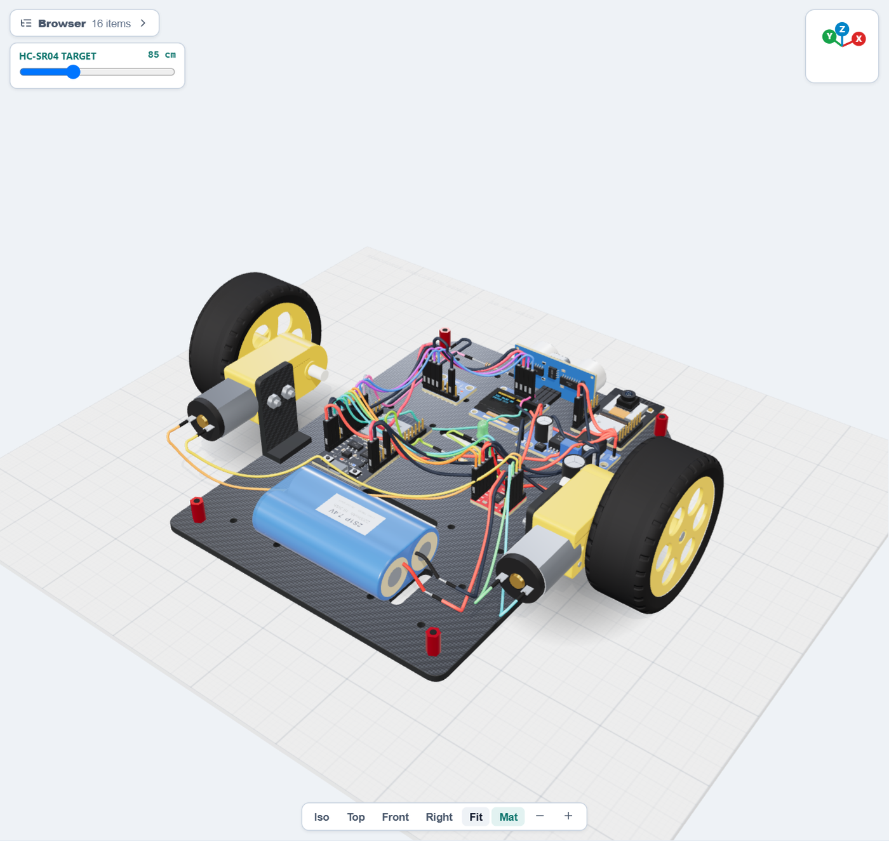
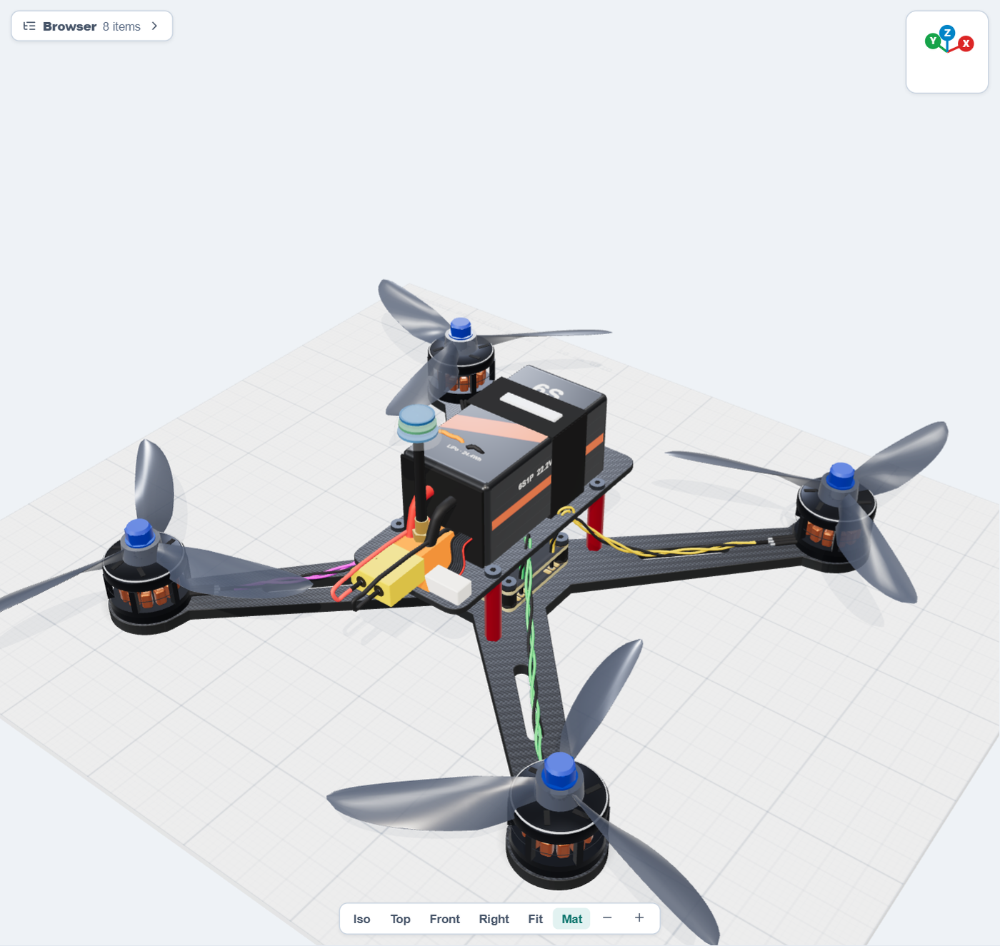
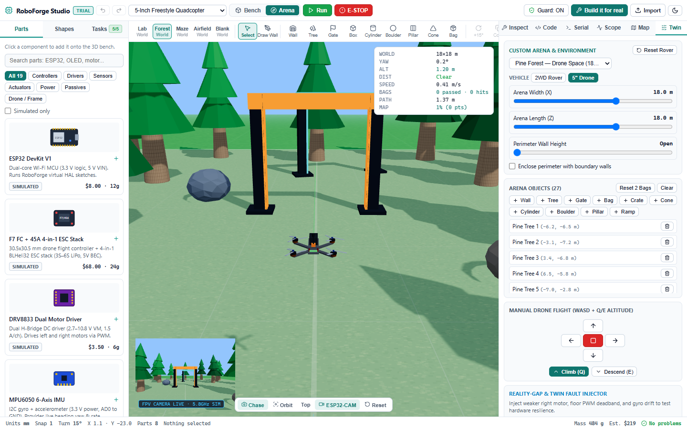
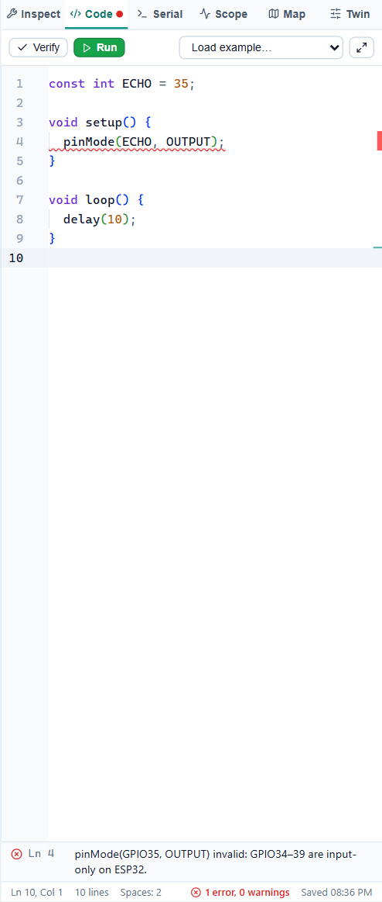
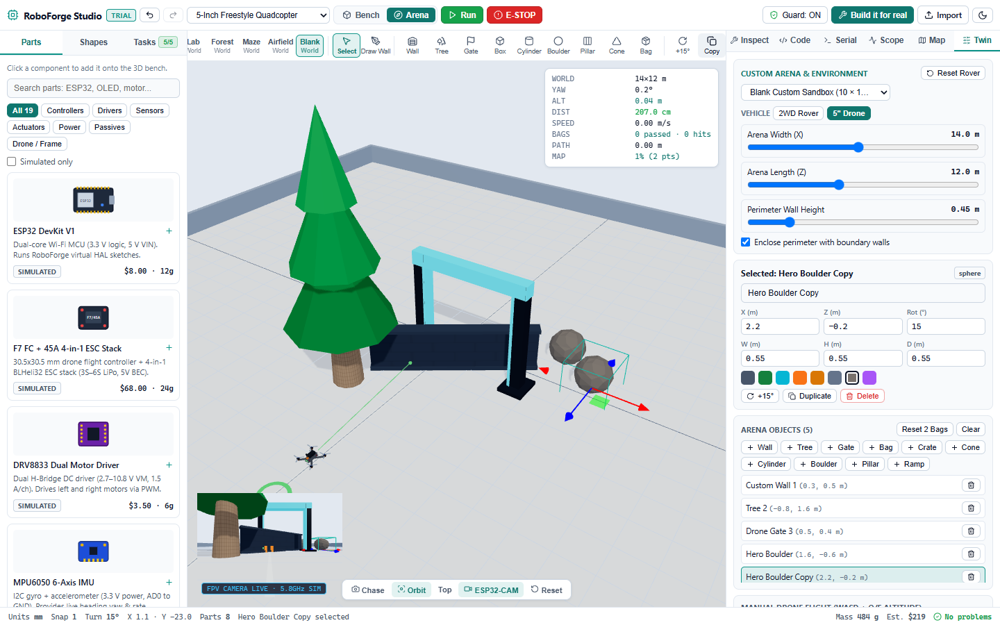
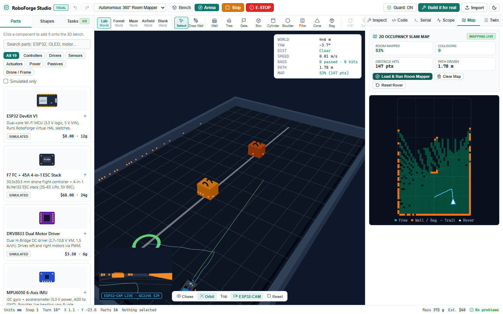
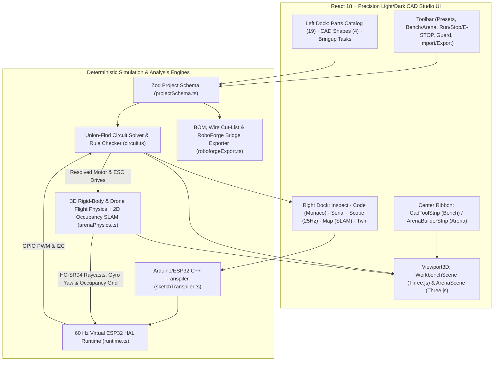

# RoboForge Studio

**RoboForge Studio** is a browser-based 3D bench for small robots and drones: real-size electronics parts you wire
pin to pin, an electrical rule and fault checker, an Arduino/ESP32 C++ editor that runs your sketch on a virtual
ESP32 (60 Hz HAL), a 4-channel scope, a 2D occupancy mapper, and a 3D physics arena (`cannon-es` + `Three.js`).

Everything runs locally in the browser; nothing needs a server or an account.

---

## Visual Preview

| 3D Electronics Workbench (2WD Rover) | Close-Up: real headers, modules and hanging wires |
| :---: | :---: |
|  |  |

| 5" Freestyle Quadcopter Workbench | Pine Forest 3D Drone Space & FPV Camera |
| :---: | :---: |
|  |  |

### Parts modelled from datasheets

Every part is built at its real size from datasheet drawings and photos: the 30-pin ESP32 DevKit V1 with its
ESP-WROOM-32, CP2102 and AMS1117; the red HW-627 DRV8833; the GY-521, HC-SR04, SSD1306 OLED and AI-Thinker
ESP32-CAM; a TT gearmotor on a 65 mm wheel; a 2207 motor with a lofted 5" tri-blade; an FPV stack, an LM2596
buck, LiPo and Li-ion packs, and the passives. Headers sit at 2.54 mm and a wire's DuPont socket lands on the pin
that is drawn; leads and pads get soldered joints. Dimensions, pin orders and sources are listed in
[docs/06_COMPONENT_REFERENCES.md](docs/06_COMPONENT_REFERENCES.md), including what is simplified.

### Sketch editor



- **Checks as you type**: missing `;`, undeclared names (with "did you mean"), unsupported C++ and calls the
  simulator does not model are underlined on the exact line and listed under Problems (click to jump).
- **Runtime faults point at the line** that caused them (for example `pinMode(35, OUTPUT)` on an input-only pin).
- **A runaway loop cannot freeze the page**: every loop form is guarded, and a loop that runs 8 s without
  `delay()` is stopped with a message naming its line.
- **C++ behaviour sketches rely on**: integer variables truncate and wrap, uninitialised variables start at zero,
  enums, `String` helpers, `sizeof(a)/sizeof(a[0])`, `Serial.print(x, HEX)`.
- **Autocomplete, hover help and parameter hints** for the virtual ESP32 API, light/dark themes, a wide mode.
- **Your work is kept**: the build and sketch are saved in this browser and restored on reload; loading an example
  or a preset asks first, and an example load can be undone with Ctrl+Z.

| Shortcut | Action |
| --- | --- |
| Ctrl+S | Verify the sketch and save |
| Ctrl+Enter | Run on the virtual ESP32 |
| Esc (in the editor) | Stop the sketch |
| F8 / Shift+F8 | Next / previous problem |

<br clear="right" />

| Interactive 3D Custom Arena Builder | Autonomous 360° Zero-Collision Room Mapper |
| :---: | :---: |
|  |  |

---

## Documentation Index (`docs/`)

All documentation is organized in order inside [`docs/`](docs/):

1. **[01 — Competitive Research & Gap Analysis](docs/01_RESEARCH_AND_GAP_ANALYSIS.md)**
   - Deep-dive breakdown of **Constructa (AtumX)** and **BenchTwin**, feature comparison matrix against RoboForge, what we adopted, and what RoboForge uniquely brings (Reality-Gap motor/gyro/friction physics, SLAM mapping, and hardware bridge export).
2. **[02 — System Architecture & Implementation Guide](docs/02_ARCHITECTURE_AND_IMPLEMENTATION.md)**
   - File-by-file codebase map (`31` TypeScript/React modules + `4` Vitest test suites), Zod project schema, Union-Find electrical circuit solver, C++-to-JS sketch transpiler & 60 Hz virtual ESP32 runtime, `cannon-es` physics engine, 2D occupancy SLAM grid, autonomous 360° room mapper algorithm, and the `roboforge-studio-bridge/v1` exporter.
3. **[03 — Visual Fidelity, 3D Component Catalog & CAD Wiring System](docs/03_VISUAL_FIDELITY_COMPONENTS_AND_WIRING.md)**
   - How all **23 procedural 3D components** are built from scratch (FR-4 PCB silkscreens, ENIG gold pads, gull-wing IC leads, 12-pole wound copper brushless stators, lathe-turned hourglass resistors, internal LED reflector anvils, Y-scored electrolytic caps), `RoomEnvironment` PBR lighting, and the **hanging-wire system**: each wire is laid like a real jumper (gravity, fixed length, bend limit) and rests on the deck and the parts it crosses, with DuPont sockets, solder joints, twisted ESC looms and `"Route by hand"` cable clips.
4. **[04 — Customizable 3D Arena & Multi-Environment Builder](docs/04_CUSTOMIZABLE_ARENA_AND_ENVIRONMENTS.md)**
   - Complete guide to the 5 one-click environment worlds (`Indoor Lab`, `Pine Forest — Drone Space`, `Warehouse Maze`, `FPV Drone Race Airfield`, `Blank Custom Sandbox`), live width/length/wall-height resizing, 2-click `Draw Wall` tool, click-to-place 3D obstacles/trees/fly-through gates/boulders, and dual 2WD Rover + 6-DOF 5" Quadcopter Drone flight physics.
5. **[05 — Development Progress, Verification Matrix & Integration Roadmap](docs/05_PROGRESS_VERIFICATION_AND_ROADMAP.md)**
   - Phase-by-phase build log, bugs caught and resolved during testing, exact unit test and headless Chrome WebGL Playwright E2E verification results, simulation honesty notes, and the step-by-step plan for strapping RoboForge's AI planner and hardware WebSocket console onto the studio.
6. **[06 — Component References](docs/06_COMPONENT_REFERENCES.md)**
   - Real dimensions, pin orders and sources for every part, how boards, headers and packages are built, and what differs from the real parts.

---

## Quickstart & Commands

Install once with `bun install`, then (all from the repository root, using **Bun**):

```powershell
# 1. Start the local dev server on http://127.0.0.1:8060/
bun run dev

# 2. Strict TypeScript check (tsc --noEmit)
bun run typecheck

# 3. ESLint check (strict TypeScript rules, zero `any`)
bun run lint

# 4. Run all 44 Vitest tests (circuit, physics/SLAM, runtime, sketch translation and editor checks)
bun run test

# 5. Build the production bundle into dist/
bun run build
```

---

## High-Level System Architecture


