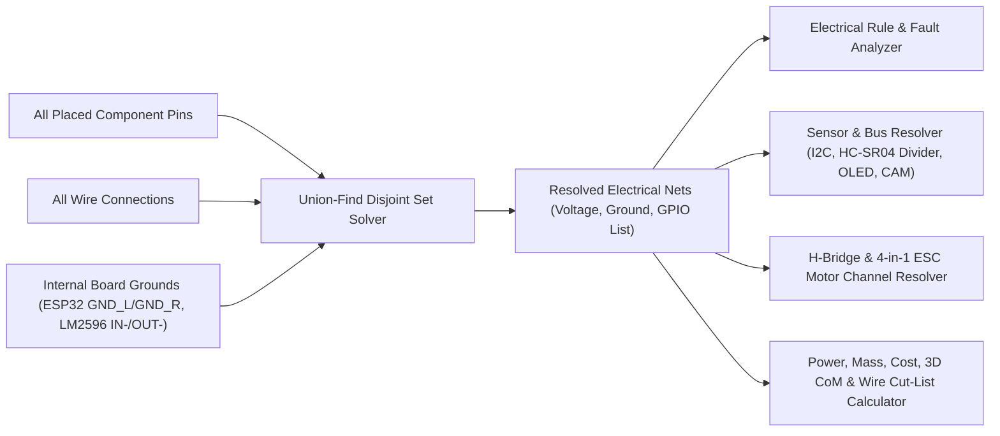

# 02 — System Architecture & Implementation Guide

## 1. Complete Source Directory Map

All source code lives under `studio_trial/src/` and is written in strict TypeScript (`"strict": true`, zero `any`).

```text
studio_trial/
├── index.html                           # Entry HTML with inline SVG RoboForge icon
├── package.json                         # Bun scripts: dev (8060), build, test, lint, typecheck
├── tsconfig.json                        # Strict TypeScript configuration
├── vite.config.ts                       # Vite 6 + React + Vitest configuration
├── eslint.config.js                     # ESLint 9 flat config (@typescript-eslint strict rules)
└── src/
    ├── main.tsx                         # React 18 root mount
    ├── App.tsx                          # Root state, undo/redo history, keyboard shortcuts, layout
    ├── styles.css                       # Light & Dark studio theme variables, CAD layout chrome
    ├── schema/
    │   └── projectSchema.ts             # Zod schemas for projects, parts, wires, waypoints, arena
    ├── catalog/
    │   ├── partsCatalog.ts              # 23 parts (19 electronic/mechanical + 4 CAD shapes) & pin specs
    │   ├── boardGeometry.ts             # Real module dimensions & pin positions shared by catalog and 3D models
    │   ├── partThumbnails.ts            # 2D SVG icons: placeholder/fallback while 3D thumbnails render
    │   ├── presets.ts                   # 5 starter presets + 5 Arduino/ESP32 C++ sketch templates
    │   └── arenaPresets.ts              # 5 customizable Arena worlds & 10 obstacle/nature element specs
    ├── engine/
    │   ├── circuit.ts                   # Union-Find netlist solver, electrical rules, BOM/CoM/cut-list
    │   ├── sketchTranspiler.ts          # Arduino/ESP32 C++ checks (line/column) and line-preserving translation
    │   ├── halApi.ts                    # Virtual ESP32 API list: name checks, autocomplete, hover & hints
    │   ├── runtime.ts                   # 60 Hz virtual ESP32 HAL runtime, OLED & 25 Hz scope sampler
    │   ├── arenaPhysics.ts              # cannon-es 3D rover & drone flight physics + 2D occupancy SLAM
    │   ├── roboforgeExport.ts           # Exporter for roboforge-studio-bridge/v1 JSON
    │   └── __tests__/                   # Vitest unit & deterministic simulation test suites
    │       ├── circuit.test.ts          # 8 electrical netlist, divider, short, and motor polarity tests
    │       ├── runtime.test.ts          # 5 transpiler, GPIO PWM, ultrasonic, OLED, and button tests
    │       ├── sketchTranspiler.test.ts # 23 line mapping, compile/runtime error, watchdog & C++ behaviour tests
    │       ├── arenaPhysics.test.ts     # 5 raycast, deadband, motor pull, custom wall & drone gate tests
    │       └── roomMapper.test.ts       # 3 full 28s–60s autonomous zero-collision room mapping tests
    ├── viewport/
    │   ├── materials.ts                 # Cached procedural textures (PCB silkscreens, carbon, grass, bark)
    │   ├── kit/                         # Shared parts kit: PBR materials, board artwork, PCBs, headers, packages, leads
    │   ├── parts/                       # One builder per part, grouped: controllers, modules, discretes, power, frames
    │   ├── partPreview.ts               # Offscreen renders of the 3D models for the parts list thumbnails
    │   ├── componentMeshes.ts           # Builds a part via parts/, adds pin pick targets, contact shadow, fault ring
    │   ├── wireDeckRouter.ts            # Lays natural wires in deck lanes: runs, socket drops, bridges, last overlap check
    │   ├── wireRope.ts                  # Hanging-wire solver (tight/arched/hand-routed wires, ESC looms)
    │   ├── wireRouting.ts               # Rest length per leg for hanging wires, path sampling helpers
    │   ├── wireGeometry.ts              # Tube for a solved wire path, DuPont sockets, solder joints, ESC looms
    │   ├── WorkbenchScene.ts            # Three.js 3D CAD Workbench (PMREM, gizmos, tape measure, tie points)
    │   ├── arenaMeshes.ts               # Three.js 3D Arena obstacles (trees, gates, walls)
    │   ├── arenaVehicle.ts              # The arena's rover/quad: the bench build itself (parts + wires), at real size
    │   └── ArenaScene.ts                # Three.js 3D Physics Arena + interactive wall/element placement
    └── components/
        ├── Toolbar.tsx                  # Top studio header (Undo/Redo, Presets, Bench/Arena, Run/Stop, Guard)
        ├── PartsPanel.tsx               # Left dock (Parts catalog, CAD Shapes, live Bringup Tasks)
        ├── CadToolStrip.tsx             # Center workbench toolbar (Shapes, Select/Wire/Move/Lift/Turn, Measure)
        ├── ArenaBuilderStrip.tsx        # Center arena toolbar (5 Worlds, Select, Draw Wall, 9 Drop-In Elements)
        ├── Viewport3D.tsx               # 3D canvas host, Browser tree, AxisGizmo, Camera bar, Telemetry HUD
        ├── AxisGizmo.tsx                # Interactive 3D X/Y/Z orientation widget in top-right of workbench
        ├── InspectorPanel.tsx           # Right dock: contextual Part Inspector, Wire Card & Circuit Checks
        ├── CodePanel.tsx                # Right dock: Monaco sketch editor, live Problems, Verify/Run/Stop, status bar
        ├── sketchLanguage.ts            # Editor themes, autocomplete, hover help & parameter hints
        ├── ConfirmDialog.tsx            # Asks before a preset or example replaces your work
        ├── SerialPanel.tsx              # Right dock: bi-directional 115200-baud Serial Monitor & command input
        ├── LogicPlotterPanel.tsx        # Right dock: 4-channel 25 Hz PWM/GPIO live oscilloscope canvas
        ├── MapPanel.tsx                 # Right dock: live 2D Occupancy SLAM Map canvas & Room Mapper launcher
        ├── ArenaControlsPanel.tsx       # Right dock: Arena dimensions/walls, Obstacle Inspector, Flight/Drive pad
        └── ExportModal.tsx              # "Build it for real" modal (BOM, Wire Cut-List, Bridge Spec, Project JSON)
```

---

## 2. Project Schema & Undo/Redo State (`projectSchema.ts`, `App.tsx`)

### 2.1 Zod Schema Validation
Every project saved or imported via JSON is validated by `StudioProjectSchema` in `src/schema/projectSchema.ts`:
- **`components`**: Array of `ComponentInstance` (`id`, `kind`, `label`, `position: [x, y, z]` in cm, `rotationY` in radians, optional `side`, `color`, `sizeOverride`).
- **`wires`**: Array of `WireConnection` (`id`, `from: { componentId, pinId }`, `to: { componentId, pinId }`, `color`, `style: 'routed' | 'direct' | 'arched'`, `clearanceCm`, and optional manual tie-point `waypoints: Vec3[]`).
- **`arena`**: Optional `ArenaConfig` (`environment: 'indoor_lab' | 'forest_park' | 'warehouse_maze' | 'drone_course' | 'sandbox_open'`, `widthM`, `lengthM`, `wallHeightM`, `enclosed`). Falls back cleanly to `DEFAULT_ARENA_CONFIG` (`4.0 × 6.4 m` indoor lab) when importing older project files.
- **`obstacles`**: Array of `ArenaObstacle` (`id`, `kind` across 10 types, `label`, `position`, `size`, `color`, `rotationY`).
- **`faults`**: `TwinFaultConfig` (`leftMotorScale`, `rightMotorScale`, `minStartPwm`, `gyroDriftDegPerSec`, `floorFriction`, `usNoiseCm`).

### 2.2 Single-State Undo/Redo History
In `src/App.tsx`, `history` is stored in a single atomic React state object `{ past: StudioProject[], present: StudioProject, future: StudioProject[] }` (up to 30 steps) so `Ctrl+Z` / `Ctrl+Y` and toolbar Undo/Redo buttons work deterministically under React 18 StrictMode.

---

## 3. Graph-Based Electrical Netlist & Rule Engine (`circuit.ts`)

Whenever `project.components` or `project.wires` changes, `analyzeCircuit(project)` runs in `src/engine/circuit.ts`:



### 3.1 Electrical Fault & Diagnostic Rules
The engine classifies issues into four severities (`critical`, `error`, `warning`, `info`):
1. **Direct Power-to-Ground Short (`critical`):** Detects any net where a `power_out` pin (`2S BAT+`, `6S XT60+`, `LM2596 OUT+`, `ESP32 3V3`, `FC 5V BEC`) is shorted directly to `GND`.
2. **Pin Overvoltage (`critical`):** Flags any pin receiving a net voltage above its `maxVoltage` rating (e.g., wiring `7.4 V` 2S battery power directly into `ESP32 VIN` rated `5.8 V` max, or `22.2 V` 6S LiPo into a `5 V` peripheral).
3. **Circuit Guard Interlock:** When `Guard: ON` is active in the top toolbar, any `critical` fault blocks `Run`, automatically switches the right dock to `Inspect`, and displays a prominent red banner (`Blocked by Circuit Check: ...`). Toggling `Guard: OFF` allows intentionally running fault experiments.
4. **ESP32 Input-Only GPIO Violation (`error`):** Detects if `GPIO34–39` (such as `GPIO35`) is wired to a `DRV8833` motor input or `HC-SR04 TRIG` pin that requires output drive.
5. **HC-SR04 5V ECHO Voltage Divider Check (`warning`):** Traces resistor neighbor nets from `HC-SR04 ECHO` through `resistor_10k` instances. If `5 V ECHO` is wired directly into `GPIO35` without a two-resistor divider to `GND`, it warns the user and explains how to wire the `10k / 10k` divider.
6. **LED Series Resistor Check (`warning`):** Verifies that every `led_5mm` has a `resistor_10k` in series between its GPIO drive net and `GND`.
7. **Boot-Strapping Pin Check (`warning`):** Warns when motor driver inputs are wired to ESP32 boot-strapping pins (`GPIO0`, `GPIO2`, `GPIO12`, `GPIO15`).
8. **Split Ground Rail Detection (`warning`):** Warns if active modules are connected to separate, unbridged `GND` nets.
9. **Motor Rail Bulk Capacitor (`info`):** Recommends placing a `cap_1000uf` across `DRV8833 VM` and `GND`.

---

## 4. Offline Arduino/ESP32 C++ Transpiler & 60 Hz Virtual Runtime

### 4.1 Sketch Transpiler (`sketchTranspiler.ts`)
`transpileArduinoSketch(source)` converts Arduino/ESP32 C++ sketches into an executable async JavaScript function with zero network calls:
- Strips preprocessor directives (`#include`) and comments while preserving line structure.
- Converts typed C++ array declarations (`float scans[20];`, `int pins[] = {25, 26};`), typed function signatures (`float readSafeCm()`, `void setup()`), variable declarations (`unsigned long`, `const int`, `float`, `bool`, `String`), and C-style scalar casts (`(int)`, `(float)`).
- Injects `await __rt.tick()` inside `while` and `for` loop bodies so tight user loops yield cleanly to the 60 Hz simulation clock and respect `Stop` / `E-STOP` immediately.
- Validates syntax via `new Function('__rt', ...)` and returns compiler error messages to the Monaco editor's `Verify` banner.

### 4.2 Virtual ESP32 HAL Runtime (`runtime.ts`)
`VirtualEsp32Runtime` executes transpiled `setup()` and repeated `loop()` ticks against the live circuit analysis:
- **Supported HAL APIs:**
  - `pinMode(pin, INPUT | OUTPUT | INPUT_PULLUP)`
  - `digitalWrite(pin, HIGH | LOW)` and `digitalRead(pin)` (reads live 3D `tactile_button` clicks!)
  - `analogWrite(pin, 0..255)` and `ledcWrite(pin, 0..255)`
  - `delay(ms)`, `delayMicroseconds(us)`, `millis()`
  - `Serial.begin(baud)`, `Serial.print(...)`, `Serial.println(...)`, `Serial.available()`, `Serial.readStringUntil('\n')`
  - `ultrasonicReadCm(trigPin, echoPin)` (verifies `HC-SR04` is wired to those exact GPIOs before returning the live 3D Arena raycast or Workbench target slider distance)
  - `imu.begin()`, `imu.readYawDeg()`, `imu.readYawRate()`, `imu.zeroYaw()` (checks `MPU6050` I2C wiring on `GPIO32/33`)
  - `oled.begin()`, `oled.clear()`, `oled.print(...)`, `oled.println(...)`, `oled.display()` (repaints the live 3D `0.96" SSD1306` OLED canvas texture on the workbench!)
- **Deterministic Test Clock Hook:** Accepts a custom `clock: { now, setTimer, clearTimer }` so Vitest tests can simulate 60 seconds of autonomous driving in under 200 ms of wall-clock time.

---

## 5. Autonomous 360° Zero-Collision Room Mapper (`ROOM_MAPPING_SKETCH`)

Defined in `src/catalog/presets.ts` (and available via the `Autonomous 360° Room Mapper` preset or the `Load & Run Room Mapper` button in the `Map` tab):
1. **360° In-Place Sector Scan (`perform360Scan`):**
   - Rotates in 18 discrete `20°` increments using PD gyro heading control (`imu.readYawDeg()`, `imu.readYawRate()`).
   - At each stop, takes a dual-sample conservative ultrasonic reading (`readSafeCm()`), which simultaneously populates the 3D Arena orange scan point cloud and the 2D SLAM occupancy grid (`ArenaPhysicsEngine.recordRayIntoMap`).
2. **Smoothed Corridor Selection:**
   - Scores every heading using a 3-sector weighted window (`0.5 * center + 0.25 * left + 0.25 * right`) plus an exploration angular bonus so the rover systematically explores new room quadrants instead of oscillating back and forth.
3. **Sinusoidal Fan-Weaving Cruise:**
   - Aligns to the winning corridor heading and cruises forward for up to `3.4 s` while weaving `±10°` (`10.0 * sin(elapsed * 0.006)`).
   - Sweeping the forward ultrasonic cone left and right during motion detects off-center bags, crates, and walls early and halts cleanly whenever frontal clearance drops below `SAFE_FRONT_CM = 62.0 cm`.

---

## 6. RoboForge Hardware Bridge Exporter (`roboforgeExport.ts`)

Clicking **`Build it for real`** opens `ExportModal.tsx` with three views:
1. **BOM & Wire Cut-List:** Itemized component table (`Qty`, `Mass`, `Unit $`, `Subtotal`), power & battery runtime cards, and a color-coded **Wire Cut-List** giving the exact routed length and recommended physical cut length (`+30 mm` stripping allowance rounded to `5 mm`) for every wire.
2. **RoboForge Bridge Spec (`roboforge-studio-bridge/v1`):** Exports the resolved GPIO pin map (`leftMotorForwardGpio: 25`, `leftMotorReverseGpio: 26`, `rightMotorForwardGpio: 27`, `rightMotorReverseGpio: 14`, `ultrasonicTrigGpio: 13`, `ultrasonicEchoGpio: 35`, `mpuSdaGpio: 32`, `mpuSclGpio: 33`), sensor readiness flags, reality-gap twin parameters, and BOM summary for direct ingestion by RoboForge's Python `simlab/` and `sewerbot/` tools.
3. **Full Project JSON:** Complete `StudioProject` snapshot that can be copied, downloaded as `.studio.json`, or re-imported via the toolbar **`Import`** button.
