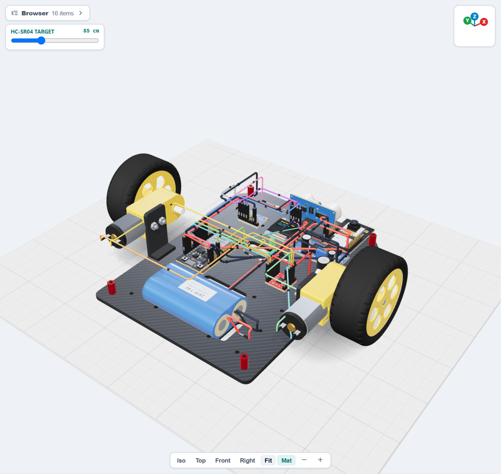
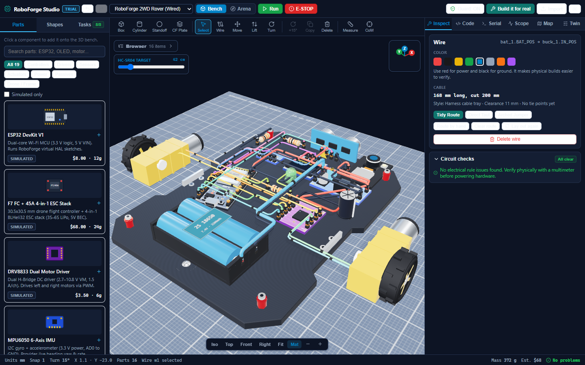
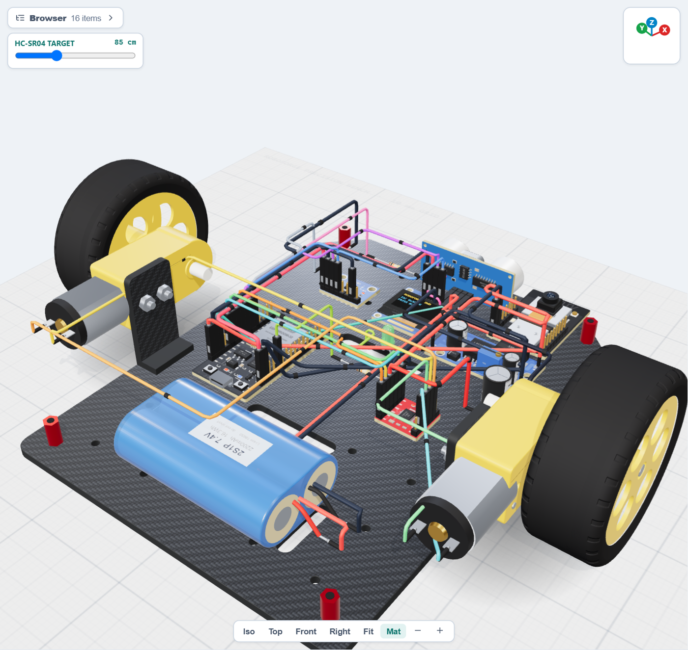

# 03 — Visual Fidelity, 3D Component Catalog & CAD Wiring System

## 1. Studio Lighting, PBR Materials & Precision Cutting Mat

To match the crisp visual standard of modern 3D CAD tools (such as BenchTwin and SolidWorks Electrical), `WorkbenchScene.ts` and `materials.ts` combine:
- **Image-Based Lighting (`RoomEnvironment` + `PMREMGenerator`):** Pre-filtered mipmapped radiance environment maps give metallic nickel shields, chrome USB shells, gold header pins, wound copper stator coils, and coated sapphire camera lenses realistic studio reflections.
- **Tone Mapping & Soft Shadows:** `THREE.ACESFilmicToneMapping` (`exposure: 1.06`) paired with a `2048 × 2048` `PCFSoftShadowMap` key light and cool fill light creates clean depth cues across stacked PCBs and wire harnesses.
- **Dual-Theme Precision Cutting Mat (`getCuttingMatTexture`):** A `1024 × 1024` procedural canvas texture with `8x` anisotropic filtering renders `2 mm` minor subdivisions, `10 mm` major grid lines, and `50 mm` bold reference lines in both **Light Studio** (`#dfe5ec`) and **Dark Studio** (`#111827`) palettes.

| Light Studio Workbench | Dark Studio Workbench |
| :---: | :---: |
|  |  |

---

## 2. Procedural Textures & Surface Details (`materials.ts`)

Every texture is generated procedurally in-memory at startup (100% offline, zero external image asset dependencies):
1. **High-Resolution FR-4 PCB Silkscreens (`getPcbSilkscreenTexture`):**
   - `512 × 512` top-layer textures featuring colored solder masks (slate black `#131926`, royal purple `#581c87`, deep blue `#1d4ed8`, navy `#1e3a8a`), etched copper trace lines underneath the solder mask, crisp white outer silkscreen borders, 4 corner ENIG gold mounting vias, module titles, pin-row labels (`3V3`, `GND`, `D35..D13`, `VIN..D22`, `VM`, `IN1..4`, `OUT1..4`), and X/Y coordinate arrows on the `MPU6050`.
2. **Deep Charcoal 2×2 Twill Carbon Fiber (`getCarbonTexture`):**
   - Alternating diagonal gradient cells (`#262b35` / `#111419`) tiled at `5 × 5` repeat with controlled environment reflection (`envMapIntensity: 0.45`, `roughness: 0.56`), yielding rich dark matte carbon plates that contrast sharply against chrome hardware and colored wires.
3. **Perforated Honeycomb Acoustic Screen (`getAcousticMeshTexture`):**
   - Radial metallic gradient with cross-hatched mesh lines and a bright outer bezel ring applied to the front faces of `HC-SR04` ultrasonic transducer barrels.

---

## 3. Complete Catalog of All 23 Ultra-Detailed 3D Components

All 23 components are defined in `src/catalog/partsCatalog.ts` and constructed in `src/viewport/partDetailBuilders.ts` and `src/viewport/componentMeshes.ts`:

### 3.1 Controllers & Drivers
| Kind | Part Name | Size (cm) | Mass | Price | 3D Architectural & Electronic Details |
| :--- | :--- | :---: | :---: | :---: | :--- |
| `esp32_devkit` | **ESP32 DevKit V1** | `2.8 × 0.85 × 5.5` | `12 g` | `$8.00` | FR-4 silkscreen with 20 labeled ENIG pin pads, dual 10-pin black header rails, gold inverted-F meandering PCB Wi-Fi antenna, stamped nickel `ESP-WROOM-32` RF shield can, QFN-28 `CP2102` UART with 24 gull-wing leads, `AMS1117` SOT-223 3.3V regulator with metal tab, 40 MHz silver crystal, 7 SMD 0603 caps/resistors, recessed Micro-USB port with contact tongue, `EN` & `BOOT` dome switches, red power LED, and live PWM blue `GPIO2` LED. |
| `fc_esc_stack` | **F7 FC + 45A 4-in-1 ESC Stack** | `3.6 × 1.5 × 3.6` | `24 g` | `$68.00` | Dual-deck `30.5 × 30.5 mm` drone stack: lower 45A ESC board with 24 individual MOSFET chips, gold motor solder pads (`M1–M4`), rear low-ESR filter capacitor, 4 M3 stack bolts with turquoise silicone vibration grommets and red anodized locknuts, 8-pin JST-SH interconnect ribbon, upper F7 FC board with `STM32F722` LQFP-64 IC (32 gull-wing leads), ICM gyro, metal BMP280 barometer, USB-C port, and `5V · FC1` OSD badge. |
| `drv8833` | **DRV8833 Dual Motor Driver** | `2.4 × 0.55 × 2.8` | `6 g` | `$3.50` | Royal purple PCB with `VM/GND/IN1..4/OUT1..4` silkscreen, central `HTSSOP-16` H-bridge IC with 16 silver gull-wing pins and pin-1 dimple, 4 SMD 0805 ceramic decoupling caps and sense resistors, and dual gold-pin headers. |

### 3.2 Sensors & Camera Modules
| Kind | Part Name | Size (cm) | Mass | Price | 3D Architectural & Electronic Details |
| :--- | :--- | :---: | :---: | :---: | :--- |
| `mpu6050` | **MPU6050 6-Axis IMU (GY-521)** | `2.1 × 0.45 × 1.6` | `3 g` | `$3.20` | Blue PCB with `X/Y` orientation arrows and `VCC..AD0` silkscreen, QFN-24 MEMS sensor package with 24 gull-wing leads, SMD pull-up resistors & ceramic caps, and glowing green SMD power LED. |
| `hcsr04` | **HC-SR04 Ultrasonic Sensor** | `4.5 × 2.0 × 1.5` | `9 g` | `$2.50` | Vertical cyan-blue PCB, dual machined aluminum transducer cans with chrome bezel rings and recessed perforated honeycomb acoustic mesh faces, top 4.000 MHz silver HC-49S crystal oscillator, and 3 rear SOIC-16 ICs (`MAX232`, `LM324`, `MCU`). |
| `oled_ssd1306` | **0.96" OLED I2C Display** | `2.7 × 0.45 × 2.7` | `5 g` | `$4.50` | Navy PCB with `SSD1306` silkscreen and corner M2 vias, glossy black glass bezel, folded amber Kapton flex-PCB ribbon tail, and live `256 × 128` canvas texture rendering dual-zone yellow/cyan `oled.println()` output in 3D. |
| `esp32_cam` | **ESP32-CAM (GC2145)** | `2.7 × 1.0 × 4.0` | `11 g` | `$9.50` | Matte black PCB, stamped chrome micro-SD card cage with slot recess, white ZIF connector latch, orange Kapton FPC camera ribbon, multi-step anodized lens barrel with chrome focus ring and coated blue sapphire glass, and high-power 5050 phosphor flash LED in silver reflector cup. |
| `tactile_button` | **Tactile Push Button (6mm)** | `1.0 × 0.9 × 1.0` | `1 g` | `$0.15` | Omron-style `6 × 6 mm` switch with black housing, stainless cover plate, 4 corner heat-stake rivets, 4 bent gull-wing leads, and clickable red plunger that depresses in 3D to trigger `digitalRead()`. |

### 3.3 Actuators, Power & Passives
| Kind | Part Name | Size (cm) | Mass | Price | 3D Architectural & Electronic Details |
| :--- | :--- | :---: | :---: | :---: | :--- |
| `dc_motor` | **TT DC Gearmotor + Wheel** | `3.8 × 3.2 × 6.5` | `48 g` | `$4.00` | Ribbed yellow ABS gearbox housing, white axle boss, brushed nickel 130 DC motor barrel, matte black endbell, dual brass solder tabs bridged by an orange ceramic noise-suppression disc capacitor, 5-spoke yellow rim with dark inner dish & chrome hub cap, and 65 mm tire with chamfered sidewalls and 18 staggered knobby rubber tread lugs. |
| `brushless_2207` | **2207 1950KV Motor + 5" Prop** | `2.8 × 3.0 × 2.8` | `34 g` | `$16.50` | Spoked mounting flange with 4 M3 hex socket screws, **12 individual vertical wound copper stator coils**, open-windowed gunmetal rotor bell with 6 vertical ribs and chrome chamfer ring, swept 3-blade translucent polycarbonate airfoil propeller, knurled blue anodized M5 flanged locknut, and titanium shaft tip. |
| `battery_2s` | **2S Li-Ion Pack (7.4V 2200mAh)** | `3.8 × 1.9 × 6.8` | `95 g` | `$12.00` | Contoured twin-bay black ABS sled with central cell divider wall, 3-coil helical chrome negative compression springs, two cyan-blue 18650 lithium cells with white PVC insulating rings and nickel button caps, and top specification plate. |
| `battery_6s_lipo` | **6S LiPo 1100mAh (22.2V XT60)** | `3.6 × 3.4 × 7.2` | `195 g` | `$28.00` | 6-cell graphite shrink-wrapped brick with horizontal cell seam ridges, amber Kapton protective end-wrap, rubberized Velcro battery strap with chrome cinch buckle, side white 7-pin JST-XH balance plug, and sculpted yellow **XT60H** D-profile connector housing with dual gold 3.5 mm bullet sockets. |
| `lm2596_buck` | **LM2596 Buck Converter (5.2V)** | `4.3 × 1.4 × 2.1` | `12 g` | `$2.20` | Blue PCB with `IN+ / IN- / OUT+ / OUT-` silkscreen, `TO-263-5` LM2596S regulator IC with chrome heatsink tab, large shielded wire-wound `330` power inductor, `SS34` Schottky diode with cathode band, dual scored aluminum SMD electrolytic capacitors, and blue Bourns `3296W` multi-turn trimpot with slotted brass adjustment screw. |
| `resistor_10k` | **Resistor 10 kOhm (1/4W)** | `2.2 × 0.5 × 0.6` | `1 g` | `$0.05` | `THREE.LatheGeometry` peanut/hourglass tan ceramic body, 4 color-code rings (`Brown-Black-Orange-Gold`), and formed axial tinned-copper leads bending down into the bench. |
| `led_5mm` | **5mm Status LED** | `1.0 × 1.4 × 1.0` | `1 g` | `$0.10` | Semi-transparent optical epoxy dome with flanged base ring, **visible internal chrome reflector cup (cathode anvil) and anode post**, and dual tinned leads. Glows dynamically with GPIO PWM. |
| `cap_1000uf` | **1000uF 16V Electrolytic Cap** | `1.2 × 2.0 × 1.2` | `4 g` | `$0.35` | Radial dark-navy aluminum cylinder with crimped neck ring, **stamped Y-scored aluminum pressure-relief vent top**, white negative polarity stripe, and radial leads. |

### 3.4 Frames & Structural CAD Primitives
| Kind | Part Name | Size (cm) | Mass | Price | 3D Architectural & Electronic Details |
| :--- | :--- | :---: | :---: | :---: | :--- |
| `chassis_2wd` | **2WD Carbon Rover Chassis Deck** | `14.4 × 0.45 × 19.2` | `115 g` | `$14.00` | Extruded beveled carbon-fiber deck with tapered nose, left/right wheel-well cutouts, 3 centerline CNC wire slots, 4 knurled red anodized M3 hex standoffs with chrome hex-socket screws, dual aluminum motor L-brackets, and rear stainless swivel ball caster assembly. |
| `frame_quad_5in` | **5-Inch Carbon Freestyle X-Frame** | `22.0 × 3.2 × 22.0` | `118 g` | `$42.00` | True-X carbon arms with CNC lightening cutouts and flared motor pads, chamfered lower & upper carbon fuselage plates, textured black foam anti-slip LiPo pad, 6 knurled red M3 standoffs with socket screws, CNC aluminum FPV camera side plates, and micro FPV camera with red focus ring and coated blue glass lens. |
| `vtx_antenna` | **5.8GHz FPV Antenna + TPU Mount** | `1.8 × 6.2 × 1.8` | `11 g` | `$14.50` | Bright orange 3D-printed TPU tail mount with dual M3 mounting sleeves, knurled brass SMA hex nut & thread, semi-rigid coax stem, and domed circularly-polarized lollipop radome with orange accent ring. |
| `cad_box` / `cad_cylinder` / `cad_standoff` / `cad_plate` | **Structural CAD Shapes (4)** | Custom | `3–14 g` | `$0.30–$2.50` | Movable, liftable, rotatable structural primitives including knurled red M3 standoffs with socket screws and 4-bolt woven carbon mounting plates. |

---

## 4. Top-Notch CAD Cable Harness Routing System (`wireGeometry.ts`)

### 4.1 Why Splines Were Replaced with Filleted Orthogonal Polylines
Standard 3D curve splines (`CatmullRomCurve3`) overshoot sharp corners and bow outward into mid-air like springy hair. In `src/viewport/wireGeometry.ts`, we implemented **`buildFilletedCurvePath(points, bendRadius)`**:
- Every straight run is an exact `THREE.LineCurve3` segment (zero curvature, zero sag or bowing).
- At every interior bend `(P[i-1], P[i], P[i+1])`, the incoming and outgoing lines are trimmed back by `r = min(bendRadius, lenIn * 0.4, lenOut * 0.4)` and joined by an exact `THREE.QuadraticBezierCurve3` fillet (`r ≈ 0.24–0.30 cm`).

### 4.2 Obstacle-Avoiding Bus Lanes & Stratified Elevations
`computeHarnessPoints` evaluates 5 candidate orthogonal routes (`candA` horizontal-first, `candB` vertical-first, `candC` central chassis spine, `candD1` rear gutter, `candD2` front gutter) against the 2D bounding boxes (`ComponentFootprint[]`) of all placed PCBs and batteries:
- Routes that cross tall components receive a high collision penalty (`hits * 32 + length`) so wires automatically detour around the `ESP32` RF shield and `2S 18650` battery pack.
- **Parallel Ribbon Spacing:** Each wire is assigned a deterministic lane slot (`laneOffset = ((laneIndex % 5) - 2) * 0.17 cm`) and stratified tray elevation (power rails hug the lower deck while GPIO/I2C signal buses run cleanly above), forming neat parallel ribbon bundles.
- **Cable-Tie Collars:** Long routed segments (`> 6.5 cm`) automatically receive matte-black cylindrical cable-tie collars at `35%` and `65%` span.

### 4.3 Authentic 2.54 mm DuPont Connectors & 3-Conductor ESC Looms
- **DuPont Female Housings (`addDupontHousing`):** Every pin connection renders a square matte-black 2.54 mm housing (`0.21–0.24 cm` wide, `0.36 cm` tall) with a recessed metallic silver retention crimp window on the side and a color-matched tapered strain-relief collar.
- **3-Conductor Brushless ESC Motor Looms:** Wires connected to `esc_phase` pins automatically render as a **3-wire parallel motor phase ribbon** (colored outer phases + black center wire) cinched tightly to the carbon quadcopter arm with dual rectangular black zip-tie bands.
- **Interactive Manual Routing (`Route by hand`):** Selecting any wire and clicking **`Route by hand`** in the Inspector lets the user click directly on the 3D workbench to place custom tie-down clips (`waypoints: Vec3[]`), updating both the 3D harness path and the millimeter cut-length in real time.
