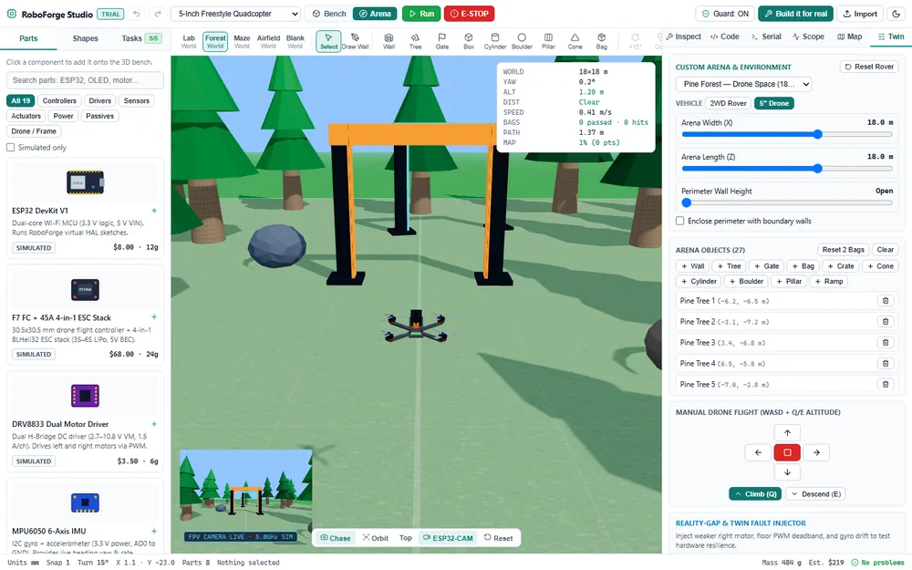
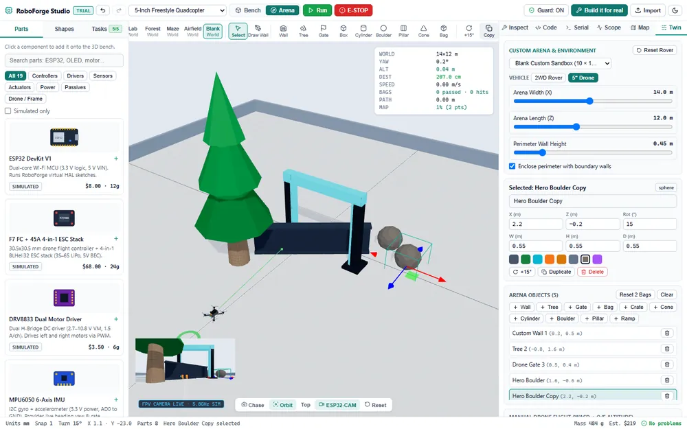

# 04 — Customizable 3D Arena & Multi-Environment Builder

## 1. Overview

In **Arena Mode**, `studio_trial/` provides a full **3D Environment & Obstacle Builder** (`ArenaBuilderStrip.tsx`, `ArenaControlsPanel.tsx`, `ArenaScene.ts`, `arenaMeshes.ts`, and `arenaPhysics.ts`). Users can switch between 5 pre-built worlds, reshape the arena's width, length, and wall height on the fly, draw custom walls point-to-point on the floor, drop in trees, FPV drone gates, boulders, crates, and geometric shapes, and test either a **2WD Ground Rover** or a **6-DOF 5-Inch Quadcopter Drone**.

| Pine Forest — 3D Drone Space (`18 × 18 m`) | Custom Sandbox Builder (`14 × 12 m`) |
| :---: | :---: |
|  |  |

---

## 2. Five One-Click Environment Worlds (`arenaPresets.ts`)

Accessible from both the top **`ArenaBuilderStrip`** (`Lab`, `Forest`, `Maze`, `Airfield`, `Blank` World buttons) and the **`CUSTOM ARENA & ENVIRONMENT`** dropdown in the `Twin` tab:

| World ID | Name | Default Size | Perimeter Walls | Environment & Pre-Placed Elements |
| :--- | :--- | :---: | :---: | :--- |
| `indoor_lab` | **Indoor Robotics Lab** | `4.0 × 6.4 m` | Enclosed (`0.24 m` curb) | Dark slate epoxy floor, 0.5 m grid, white centerline tape, green start ring, and 2 brown demo bags (`bag_1`, `bag_2`). Default for `RoboForge 2WD Rover` and `Autonomous 360° Room Mapper`. |
| `forest_park` | **Pine Forest — Drone Space** | `18.0 × 18.0 m` | Open (`0 m`, vast grass surround) | Bright daylight blue sky (`#93c5fd`), horizon fog, textured sunlit grass meadow, **23 multi-tier conifer pine trees**, 2 mossy boulders, and 2 fly-through FPV racing gates. Default for `5-Inch Freestyle Quadcopter`. |
| `warehouse_maze` | **Warehouse Maze & Rooms** | `7.0 × 9.0 m` | Enclosed (`0.95 m` walls) | Brushed industrial concrete floor, 3 interior masonry partition walls forming corridors and doorways, 2 wooden pallet crates, and an apex traffic cone for multi-room SLAM exploration. |
| `drone_course` | **FPV Drone Race Airfield** | `16.0 × 18.0 m` | Open (`0 m`, turf field) | Outdoor airfield grass with white boundary lines, **4 glowing neon FPV racing gates** (including a high gate and chicane gates), 3 tall slalom flag pylons, and edge pine trees. |
| `sandbox_open` | **Blank Custom Sandbox** | `10.0 × 10.0 m` | Enclosed (`0.45 m` walls) | Clean architectural light-grey drafting floor with 0.5 m measurement grid and zero initial obstacles — ready for custom wall drawing and shape placement. |

---

## 3. Shaping Arena Dimensions & Perimeter Walls

Inside the **`Twin`** tab (`ArenaControlsPanel.tsx`), users can reshape any world in real time:
- **Arena Width (`X`):** `3.0 m` to `26.0 m` (`0.5 m` steps)
- **Arena Length (`Z`):** `3.0 m` to `26.0 m` (`0.5 m` steps)
- **Perimeter Wall Height:** `0.0 m` (Open) to `3.0 m` (`0.1 m` steps)
- **Enclose Perimeter Checkbox:** Toggles boundary walls on or off.

Whenever these parameters change:
1. `ArenaScene.setArenaConfig` dynamically resizes the 3D floor plane, measurement grid, centerline tape, shadow frustum, and perimeter wall meshes.
2. `ArenaPhysicsEngine.setArenaConfig` rebuilds the `cannon-es` perimeter wall rigid bodies and rescales the **2D Occupancy SLAM Grid** (`gridCellM = 0.1 m` up to `8 m`, `0.2 m` up to `14 m`, `0.3 m` up to `26 m`) while `MapPanel.tsx` automatically adapts its canvas aspect ratio.

---

## 4. Interactive 3D Arena Builder Tools (`ArenaBuilderStrip.tsx`)

When **Arena Mode** is active, the top center ribbon switches to the **Arena Builder Strip**:

### 4.1 2-Click Custom Wall Drawing (`Draw Wall`)
1. Click **`Draw Wall`** in the top strip (automatically switches the camera to `Orbit` view and locks left-click camera rotation so floor clicks never yank the camera).
2. Click the **start corner** anywhere on the arena floor.
3. Move the cursor — a live translucent teal wall preview stretches dynamically to follow the cursor length and angle.
4. Click the **end corner** to drop a solid masonry wall (`Custom Wall N`) with exact length, midpoint `(x, z)`, and `rotationY` angle, complete with coping cap, dark baseboard, and `cannon-es` physics collider.

### 4.2 Click-to-Place Obstacles, Nature & Geometric Shapes
Clicking any of the 10 element tools enters live floor-placement mode (with a translucent 3D ghost preview under the cursor) or spawns directly from the `Twin` panel:

| Element Kind | Visual 3D Model (`arenaMeshes.ts`) | Physics Collider (`arenaPhysics.ts`) |
| :--- | :--- | :--- |
| **`wall`** | Textured masonry/panel wall with concrete top coping cap, dark baseboard, and amber hazard band. | Rotated `CANNON.Box` collider (`size: [length, height, thickness]`). |
| **`tree`** | Fibrous brown bark trunk (`getTreeBarkTexture`) + **3 stacked conical pine foliage tiers** with flat-shaded conifer needles. | **2-part compound collider:** lower cylindrical trunk collider + upper cylindrical canopy collider (blocks both ground rovers and high-flying drones). |
| **`gate`** | FPV racing archway with dark steel posts, base feet, and glowing neon inner LED strips + top header banner. | **3-part open-center archway collider:** left pillar + right pillar + top crossbar. The center opening is completely unobstructed so drones and rovers fly or drive right through! |
| **`box`** | Industrial crate / block with top structural rim trim. | Rotated `CANNON.Box` collider. |
| **`cylinder`** | Smooth structural cylinder primitive. | `CANNON.Cylinder` collider. |
| **`sphere`** | Faceted dodecahedron natural boulder / sphere primitive. | `CANNON.Sphere` collider. |
| **`pillar`** | Tall cylindrical slalom column with dark base flange and glowing yellow top warning ring. | `CANNON.Cylinder` collider. |
| **`cone`** | High-visibility orange traffic cone on a square weighted black rubber base with white reflective collar. | `CANNON.Box` collider. |
| **`bag`** | Textured brown demo tote bag with dual arched top carry handles. | `CANNON.Box` collider (tracked for `bagsPassed` telemetry). |
| **`ramp`** | Inclined wedge ramp (`0.18 rad` pitch). | Pitched `CANNON.Box` collider. |

### 4.3 Selecting, Dragging, Resizing & Rotating Any Arena Object
- In **`Select`** mode, clicking any wall, tree, gate, boulder, or crate in the 3D Arena (or clicking its row in `ARENA OBJECTS`) attaches a **3D XZ `TransformControls` gizmo** and teal bounding box so you can drag it smoothly across the floor (`0.05 m` snap).
- The **`Selected: <Object>`** inspector card in the `Twin` tab lets you edit:
  - **Label** text
  - **`X (m)`**, **`Z (m)`**, and **`Rot (°)`** orientation
  - **`W (m)`** (Width), **`H (m)`** (Height), and **`D (m)`** (Depth)
  - **8 Color Swatches**, **`+15°`** step rotation, **`Duplicate`**, and **`Delete`** (or `Delete`/`Backspace` key).

---

## 5. Dual Vehicle Physics: 2WD Rover vs 5" Quadcopter Drone

**The vehicle is the one on the bench.** When you open the Arena, the build on the bench is copied in as it stands, every part and every laid wire at real size (`arenaVehicle.ts`, `WorkbenchScene.snapshotModel`); its wheels and propellers spin and its status LED follows the sketch. If the bench holds something that is not this kind of vehicle, the arena uses the bench's ready-made 2WD rover or 5" quad, built by the same part builders. The arena gets the bench's studio reflections, and the Chase camera sits close behind so the build itself is visible.

The `VEHICLE` toggle in the `Twin` panel (which auto-selects **`5" Drone`** whenever `frame_quad_5in` or `fc_esc_stack` is on the workbench, and **`2WD Rover`** otherwise) switches both the 3D vehicle model and the physics engine:

1. **2WD Ground Rover (`vehicleMode === 'rover'`):**
   - Driven by differential left/right wheel commands from the virtual ESP32 (`DRV8833` PWM on `GPIO 25/26` & `27/14`) or manual `WASD` / on-screen arrow pad.
   - Includes full **Reality-Gap** modeling: `leftMotorScale`, `rightMotorScale`, `minStartPwm` deadband, `floorFriction` traction, `gyroDriftDegPerSec`, and `usNoiseCm`.
   - Bottom-left PiP camera shows **`ESP32-CAM LIVE · GC2145 SIM`** when `esp32_cam` is wired to `5.2 V` and `GND`.
2. **5-Inch Freestyle Quadcopter (`vehicleMode === 'drone'`):**
   - 6-DOF hover and flight dynamics (`ArenaPhysicsEngine.stepDrone`) with automatic hover lift when brushless ESC motors spin or manual flight keys are pressed.
   - **Flight Controls:** `W`/`S` pitch forward/back, `A`/`D` yaw left/right, **`Q`/`E`** (or on-screen **`Climb (Q)`** / **`Descend (E)`** buttons) to control altitude from `0.08 m` up to `6.5 m`.
   - Visual attitude banking (smooth pitch and roll tilt proportional to velocity), 4 counter-rotating 3-blade propellers, live **`ALT`** readout in the top-right Arena HUD, and bottom-left **`FPV CAMERA LIVE · 5.8GHz SIM`** feed.
