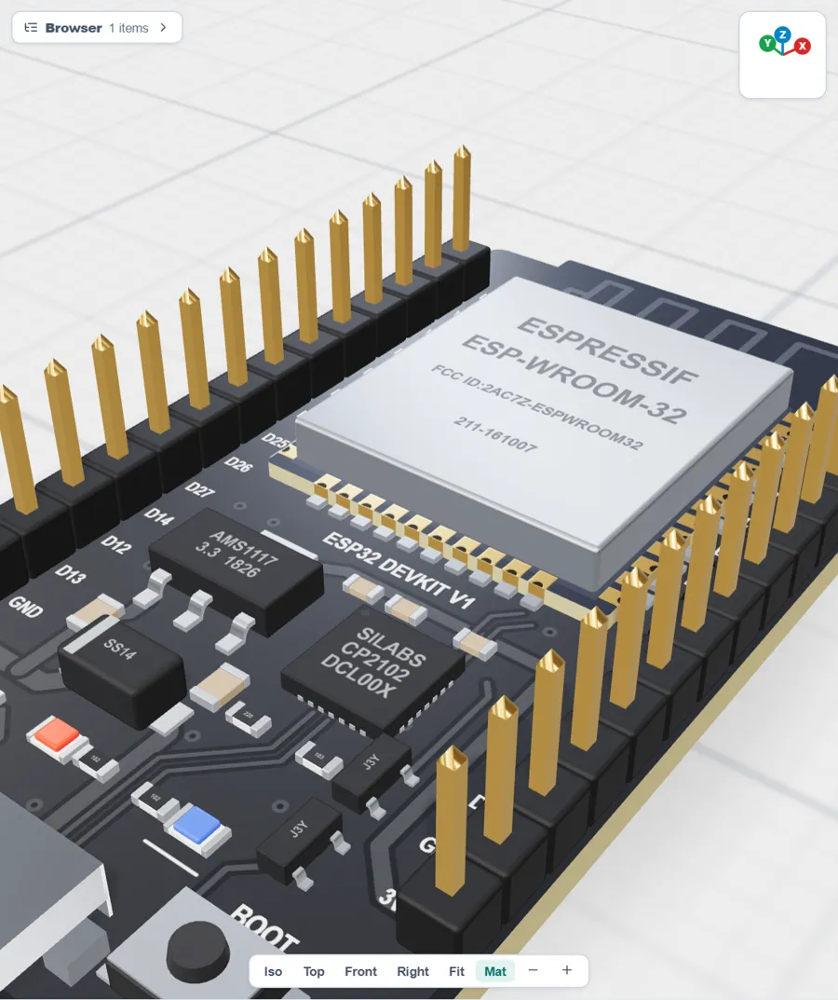
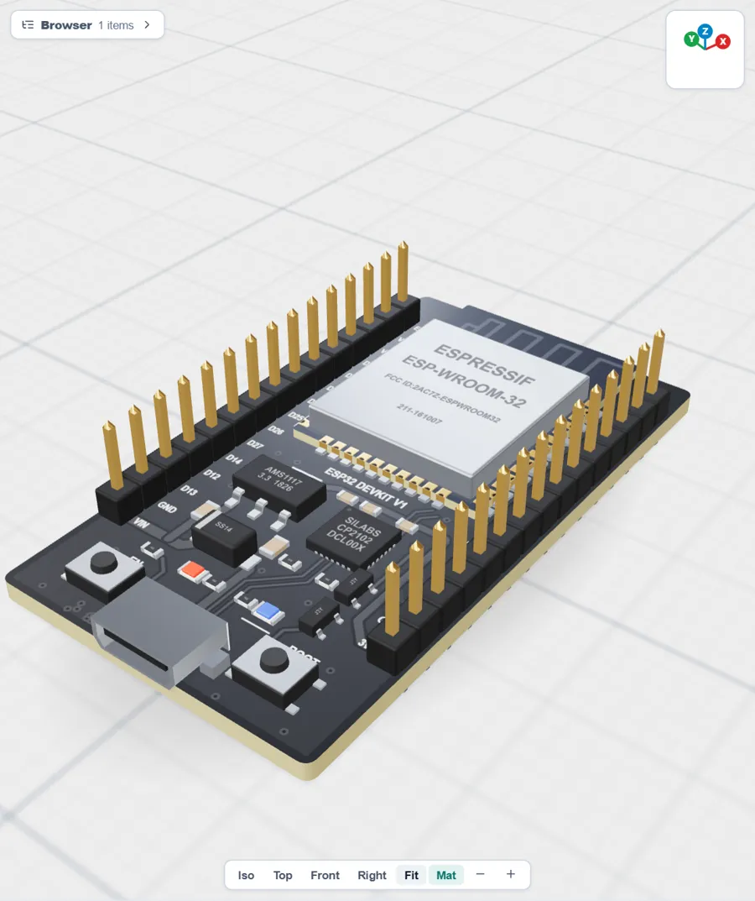

# RoboForge Studio · Parts Style Guide and Quality Rules

**Read this whole file before writing any code for a part.** It is binding. Where it disagrees with your own habits or
defaults, this file wins. Where it disagrees with the code, the code is the truth for APIs. Report the mismatch.

It covers every 3D part on the bench: boards, modules, chips, motors, batteries and frames. It is distilled from how the
existing 26 parts were rebuilt, and from the mistakes made along the way. Every rule below exists because breaking it
produced a part that looked fake or broke the wiring.

---

## 1. The bar

A part is done when a **close-up of it is hard to tell apart from a product photo** of the real thing. That means the
right size, the right number of pins at the right pitch, real chip packages with legs and markings, a real circuit
board with traces, pads, holes and silkscreen, and believable materials. A part that only reads as "roughly the right
shape from far away" is not done.

This is the existing ESP32 DevKit V1, the reference standard. Every new part must reach this level:

Seen in it:
- square gold pins with pointed tips in black plastic spacers
- a nickel shield can with its etched marking
- gold castellated module pads
- an SOT-223 regulator and an SOT-23 transistor with bent gull-wing legs
- a QFN chip, and 0603 resistors and capacitors with metal end caps
- an SMD LED and a diode
- silkscreen pin labels in a real font
- a solder mask with a faint clear-coat sheen
- tan FR-4 showing on the board edge

**Unacceptable outcomes** (any one of these means the part is rejected):
- coloured cubes, discs or cylinders standing in for pins, chips or connectors
- a board that is a single flat-coloured box, with no traces, pads, holes, silkscreen or edge colour
- the wrong pin count or pitch, or pins in the wrong order
- saturated "toy" colours, or one shiny plastic material used for everything
- parts floating above or sunk into the board, or z-fighting (flickering overlapping faces)
- text modelled as 3D geometry, or text that is unreadable, mirrored or upside down
- a part whose wires do not land exactly on its drawn pins

---

## 2. Before any code: sourcing (mandatory)

- **S1.** Find the part's **datasheet or mechanical drawing** and **at least two product photos** (top and side; the
  underside too if anything is mounted there). Use the manufacturer's site first, then distributor pages (Mouser,
  DigiKey, LCSC), then reputable hobby suppliers (Adafruit, SparkFun, Pololu). Never copy, trace or download a
  manufacturer's CAD file or images into the repo; read numbers from them and model the part yourself.
- **S2.** Write a **reference row** for the part in `docs/06_COMPONENT_REFERENCES.md` *before* modelling. It needs:
  - the real size in mm
  - the pin list in physical order
  - pitch and row spacing
  - hole positions and diameters
  - connector positions and overhangs
  - board colour, with the source for each number.
- **S3.** Mark every number you could not confirm as **"not checked against a source"**. Never invent a dimension
  silently. Plausible-looking guesses were the main source of wrong parts.
- **S4.** Count the pins on a photo and compare with the datasheet. Clone boards differ, so state which version you
  modelled (for example "DOIT 30-pin", not just "ESP32").
- **S5.** Note what sits on the **underside**: chips under a module, the backpack under an LCD, the battery holder
  under a board. The part must rest on what really holds it up: trimmed pins, standoffs, a backpack, or feet.

---

## 3. Units, frames and the single source of truth

- **U1.** Datasheet numbers stay in **millimetres** in constants; the scene is in **centimetres**. Convert only with
  `MM = 0.1` (`src/catalog/boardGeometry.ts` and `src/viewport/kit/pcb.ts`). Never type a converted number by hand.
- **U2.** The part frame:
  - The origin is at the board centre, on the bench (y = 0 is the bench surface).
  - +Y is up, and **north is -Z**: the "top" of a part as you read its silkscreen faces north unless the part says
    otherwise.
  - Board-art coordinates are mm, with x from the left edge and y from the north edge. `buildPcb(...).at(xMm, yMm)`
    converts them to the part frame.
- **U3.** **One source of truth.** Every dimension and pin position lives in a geometry constant in
  `src/catalog/boardGeometry.ts` (like `ESP32_DEVKIT`, `OLED_096`, `LCD1602_I2C`) with a pin-tip function (like
  `oledPinTip(i)`, `lcdPinTip(g, i)`). The catalog (`src/catalog/partsCatalog.ts`) builds its pin `localPos` from that
  function, and the 3D builder reads the same constant. A wire must always land on the drawn pin. Duplicated numbers
  are forbidden.
- **U4.** The **pin tip** (`PinSpec.localPos`) is exactly where a wire attaches:
  - upright header pins: the top of the pin (`HEADER_TIP_ABOVE_BOARD_MM` = 8.5 mm above the board top);
  - sideways pins: the end of the pin, with `dir` set (unit vector, for example `[-1, 0, 0]` for pins pointing west);
  - soldered points: the end of the lead or the centre of the pad, with `contact: 'lead'`.
- **U5.** **Never rename or remove an existing pin id.** Wires, presets and tests refer to them. You may add pins.
- **U6.** `sizeCm` in the catalog is the real bounding box (cm). It drives selection, framing and the contact shadow.

---

## 4. Construction rules (how to build the 3D model)

Build every part from the **kit** in `src/viewport/kit/`. Its helpers already encode real-world sizes and materials.
Hand-rolled boxes and cylinders are allowed only for things the kit does not cover, and they still have to obey every
rule below.

### 4.1 Circuit boards
- **B1.** Every PCB is made with `buildPcb({ key, wMm, dMm, cornerMm, mask, yBottom, holes, draw })`:
  - 1.6 mm FR-4 (`thicknessMm` only if the real board differs);
  - real corner radius;
  - drilled holes at their real positions;
  - tan glass-epoxy on the cut edges.
- **B2.** Everything flat on a board is drawn into its art with the `BoardPainter` passed to `draw`, in real mm. That
  includes copper traces (`trace`, with `clearanceMm` inside pours), ground pours (`pour`), exposed pads (`pad`,
  `finish: 'gold'` for ENIG and `'tin'` for HASL), plated holes (`ring`, `square: true` for pin 1), vias (`via`),
  silkscreen text and lines (`silkText`, `silkLine`, `silkRect`, `silkCircle`) and bare copper art (`copperArt`).
  **Never** model a trace, pad or silkscreen line as 3D geometry.
- **B3.** A board must show at least:
  - pads under every SMD part;
  - a plated ring at every through-hole;
  - pin labels in silkscreen where the real board has them;
  - traces connecting the main parts;
  - the part name or marking the real board shows.

  A blank board is a defect.
- **B4.** Mask colours (use the real board's colour from photos; these are the house values):

  | Board | Mask |
  | --- | --- |
  | Classic green (LCDs, many modules) | `#1f7a3a` / `#1a7a3a` |
  | Blue modules (GY-521, OLED, HC-SR04, LM2596) | `#1d4f9e`, `#1b5fa8` |
  | Black (ESP32 DevKit, FC stack, backpacks) | `#16171a`, `#17191c` |
  | Red (HW-627 DRV8833) | photo-matched red, not pure `#ff0000` |
  | Arduino teal | photo-matched teal (about `#00878f`); confirm against photos |

### 4.2 Chips and components
- **C1.** Every IC uses a package from `src/viewport/kit/packages.ts` at its true pitch: `soic`, `tssop`, `lqfp`, `qfn`,
  `sot23`, `sot223`, `to263`, `diodeSma`, `ledSmd`, `chipPassive` (`code: '0402' | '0603' | '0805' | '1206' ...`),
  `crystalHc49s`, `crystalSmd3225`, `tactSmd`, `microUsb`, `usbC`, `shieldCan`, `electrolyticRadial`,
  `electrolyticSmd`, `inductorShielded`, `trimpot3296w`. A chip is never a plain black box.
- **C2.** If a package is missing (DIP-28, USB-B, barrel jack, screw terminal...), **add it to `kit/packages.ts`** as a
  reusable function, modelled from its datasheet drawing with the same care. Examples of that care:
  - real lead count and pitch;
  - bent or formed leads, not flat stubs;
  - a pin-1 mark and moulded edge radii;
  - laser markings along the long side.

  Then use it.
- **C3.** Chip markings carry the real part number (`marking: ['ATMEGA328P', '-PU']`), drawn by the package's
  label texture. Plain text only: **never copy logo artwork, brand graphics or photos** into the model.
- **C4.** Passives: resistors, capacitors and LEDs on boards are SMD packages at their real codes. Loose through-hole
  parts use `kit/leads.ts` (`leadTube`, `bentPath`) for formed legs with real bends.

### 4.3 Pins, headers and connectors
- **P1.** 2.54 mm male headers use `addHeaderPins(group, { tips, boardTop, boardBottom })` from `kit/headers.ts`:
  - a black PA66 spacer 2.5 mm tall;
  - a 0.64 mm square pin with a pointed tip;
  - the trimmed end and solder fillet under the board.

  It draws instanced meshes. Tips come from the same pin-tip function as the catalog.
- **P2.** Pins are drawn exactly where the catalog says. Upright pins are drawn **pointing up** so DuPont sockets fit from
  above (a documented difference from boards that ship with pins pointing down). Sideways or right-angle headers get
  `dir` in the catalog and are drawn by the builder itself (see `parts/displays.ts` for the LCD backpack and
  `parts/modules.ts` for the HC-SR04).
- **P3.** **One jumper per header pin.** A header pin takes one DuPont socket (`engine/pinCapacity.ts`). Only soldered
  points (`contact: 'lead'`: component leads, pads, tabs, battery leads, splices) take several wires. Choose `contact`
  to match the real part.
- **P4.** Never draw the old coloured "candy" pin discs or role-coloured pins. Role colour shows only as the thin halo
  the app draws while wiring.

### 4.4 Materials and colour
- **M1.** Use the shared physically based materials: `PBR.*` from `kit/pbr.ts` (`gold`, `tin`, `solder`, `nickel`,
  `steel`, `steelDark`, `aluminium`, `aluminiumBrushed`, `copper`, `brass`, `headerPlastic`, `icEpoxy`, `aluminaWhite`,
  `mlcc`, `ferrite`, `rubber`, `glassBlack`, `lensGlass`, `kapton`, `carbonEdge`, `fr4Edge`). Use the helpers
  `plastic(hex, roughness, clearcoat)`, `anodised(hex)`, `siliconeJacket(hex)`, `solderMask(hex)` and `ledEmitter(hex)`.
  - No `MeshBasicMaterial` or `MeshLambertMaterial` on the part itself.
  - No `emissive` except on LEDs and screens.
  - Metal is `metalness: 1`; plastic, epoxy and ceramic are `metalness: 0`.
- **M2.** Every material reads as its real substance:
  - moulded plastics: roughness 0.45-0.65;
  - IC epoxy: almost black, slightly glossy;
  - pins: gold or tin;
  - solder: bright and slightly rougher than tin;
  - rubber: matte;
  - glass and screens: see M4.
- **M3.** Colours are matched to photos, not picked from a palette of pure hues. Pure `#ff0000`, `#00ff00`, `#0000ff`,
  `#ffff00` are forbidden.
- **M4.** **Screens and glass:** the scene uses one environment map for everything, and three.js then ignores a
  material's `envMapIntensity`. A glossy screen seen from above mirrors the studio's ceiling light and turns white.
  Lower the reflection with `MeshPhysicalMaterial({ specularIntensity: 0.1-0.15 })` and use `specularIntensity: 0` on
  the lit pixel layer (see `buildOled` and `parts/displays.ts`). Test screens in Top view.
- **M5.** Cached materials and textures are marked shared (`markShared`, done by `PBR.*` and `plastic`), so
  `disposeObject` does not free them. A one-off material you create per part must **not** be marked shared.

### 4.5 Geometry quality
- **G1.** Everything moulded or machined has rounded edges: `RoundedBoxGeometry` with a radius of 0.1-0.4 mm for small
  parts, more for big plastic housings. Sharp-cornered boxes look like placeholders.
- **G2.** Nothing floats and nothing sinks. Every mesh rests on what holds it up: the board top (`board.top`), pins,
  standoffs or feet. Check this in Front and Right views.
- **G3.** No z-fighting. Decals and labels sit at least 0.002 cm above their surface, and coplanar faces are not allowed.
- **G4.** Real thickness everywhere: boards 1.6 mm, glass about 0.7 mm, connector shells about 0.2-0.3 mm walls,
  open where the real part is open (USB mouths, header holes).
- **G5.** Curved parts (cans, cylinders, wheels, cables) use enough segments to look round in a close-up: 32-48 around
  for anything wider than 5 mm, and 12-20 for small ones.
- **G6.** Repeated small things (pins, pads, screws) use `InstancedMesh` or merged geometry (`mergeGeometries`). Budget:
  about 60k triangles for a large board and about 15k for a small module, with canvas textures at most 2048 px on a
  side.
- **G7.** Moving parts are separate objects returned to the scene: `wheelMesh`, `propMesh`, `buttonCap` (with
  `userData.restY` and `userData.travel`), `ledMaterial` for a status LED that follows a GPIO, and `display` for a
  screen (`DisplaySurface` from `viewport/displayPainter.ts`).

---

## 5. Registering a new part (all of these, every time)

1. `src/schema/projectSchema.ts`: add the kind to `ComponentKindSchema`.
2. `src/catalog/boardGeometry.ts`: add the geometry constant and the pin-tip function (section 3).
3. `src/catalog/partsCatalog.ts`: add the `PartSpec` with these fields:
   - `name`, `shortName`, the real `category`, a plain-words `description`, `massGrams`, `unitPriceUsd`;
   - `idleCurrentMa` / `peakCurrentMa` from the datasheet, `sizeCm`, `defaultColor`;
   - `pins` with `role`, `label` in the real board's words, `nominalVoltage` / `maxVoltage`, `contact` and `dir`.
4. `src/viewport/parts/<family>.ts`: the builder `PartBuilder = ({ group, spec, instance, size }) => PartBuildResult`.
   Add the meshes to `group` in the part frame.
5. `src/viewport/parts/index.ts`: add it to `PART_BUILDERS`.
6. `src/catalog/partThumbnails.ts`: an SVG fallback silhouette (the parts list normally shows a render of the 3D model).
7. `docs/06_COMPONENT_REFERENCES.md`: the reference row (section 2), including what is simplified.
8. If it carries electrical behaviour (power, GPIO, I2C, sensors), extend `src/engine/circuit.ts` and add a test.

---

## 6. Verification (a part is not done until all pass)

- **V1.** `bun run typecheck`, `bun run lint` and `npx vitest run` all pass.
- **V2.** Run `node scripts/checks/part_shots.cjs <kind> part_shots/<kind>` with the dev server on port 8070. It writes:
  - Iso, Top, Front, Right and a close-up, in the light and dark themes;
  - a low side view;
  - the console result, which must say **console: clean**.
- **V3.** Look at **every** image next to the reference photos and fix every difference you can see. Check:
  - outline and proportions;
  - pin count, order and pitch;
  - where each chip and connector sits;
  - colours;
  - whether text is readable and the right way round;
  - that nothing floats, sinks or flickers.
- **V4.** In the app, wire one jumper to every pin. Each DuPont socket or solder joint must sit exactly on the drawn pin,
  facing the right way.
- **V5.** If the part appears in a preset, `node scripts/checks/wire_overlap.cjs <presetId>` must report 0 touching pairs.
- **V6.** Report what you checked, what you could not check, and every number marked "not checked against a source".
  Do not describe a part as perfect, finished or exact. Describe what was compared, and against what.

---

## 7. Anti-patterns seen before (do not repeat)

| Seen | Why it is wrong | Do instead |
| --- | --- | --- |
| Pins as coloured discs or cylinders | No real part looks like that | `addHeaderPins` (P1) |
| A chip as a black cube | Packages have legs, edge radii, markings | `kit/packages.ts` (C1) |
| A board as one coloured box | Real boards show traces, pads, holes, silk, FR-4 edge | `buildPcb` + `BoardPainter` (B1-B3) |
| The HC-SR04 built backwards (chips facing forward) | The transducers face forward; the chips are on the back | check photos of every face (S1, S5) |
| A 30-pin board drawn with 20 pins | Pin counts are facts | count on a photo (S4) |
| An XT60 glued to the battery body | It sits on silicone leads | model what holds what (S5) |
| A gearmotor as a flat yellow box | Ribbed shell, screws, motor can, tabs | model from photos (G1, G4) |
| A white-washed OLED screen | Environment reflection on glossy glass | `specularIntensity` (M4) |
| Dimensions typed in two files | Wires miss the drawn pins | one constant + pin-tip function (U3) |

---

## 8. Starting figures for an Arduino Uno R3 (verify before use)

These numbers are a starting point from the common Arduino Uno Rev3 mechanical drawing. **Check each one against the
official Arduino Uno Rev3 documentation and photos (S1-S3) before modelling, and mark any you cannot confirm.**

- Board: 68.6 x 53.3 mm, 1.6 mm, teal mask with white silkscreen.
- Mounting holes, about 3.2 mm: four. Commonly quoted near (14.0, 2.5), (15.3, 50.7), (66.1, 7.6) and (66.1, 35.5) mm
  from the corner by the USB socket, in the drawing's own axes. Confirm the axes.
- USB-B socket (about 12 x 16 x 11 mm, overhangs the board edge about 6 mm), and a 2.1 mm DC barrel jack on the same
  edge.
- Headers: female, not male, on the top. 10-pin and 8-pin digital (D0-D13, GND, AREF, SDA, SCL) along one long edge,
  8-pin power and 6-pin analog (A0-A5) along the other. The digital headers have a known 160 mil offset between the two
  digital strips. The female socket needs its own package (C2) and its own wire end (a male jumper pin), so
  check `viewport/wireGeometry.ts` before choosing `contact`.
- Chips: an ATmega328P in a DIP-28 socket, an ATmega16U2 (QFN-32) by the USB socket, a 16 MHz crystal (HC-49/S) for the
  16U2, a ceramic resonator for the 328P, an NCP1117 / LM1117 regulator in SOT-223, and 2 x 3 ICSP headers (two).
- Also: a reset tact switch, and four SMD LEDs (L, TX, RX, ON) with their silk labels.
- Do not reproduce the Arduino logo artwork. Plain silkscreen text such as "UNO" and the pin labels is fine.

---

## 9. Definition of done (copy this list into your report and tick each line)

- [ ] Datasheet and photos found; reference row written, unverified numbers marked (S1-S5)
- [ ] One geometry constant and pin-tip function; the catalog and the builder both read it (U3)
- [ ] Existing pin ids unchanged; `contact` and `dir` set right (U5, P2, P3)
- [ ] Board made with `buildPcb`; traces, pads, holes and silkscreen drawn in the art (B1-B3)
- [ ] Every chip from `kit/packages.ts`; any new package added to the kit (C1, C2)
- [ ] Headers from `addHeaderPins`; sideways pins drawn with `dir` (P1, P2)
- [ ] Only `PBR.*` and the kit's material helpers; photo-matched colours; screens tamed (M1-M5)
- [ ] Rounded edges, nothing floating or sinking, no z-fighting, real thicknesses (G1-G5)
- [ ] Triangle and texture budget kept; repeats instanced (G6)
- [ ] All eight registration steps done (section 5)
- [ ] Typecheck, lint and tests pass (V1)
- [ ] `part_shots.cjs` images reviewed against photos; console clean (V2, V3)
- [ ] A jumper on every pin lands on the drawn pin (V4)
- [ ] Report lists what was checked, against what, and what was not (V6)

---

## 10. How to ask for a part (prompt template)

> Read `docs/PARTS_STYLE_GUIDE.md` completely and follow it strictly. Build the **<part name, exact version>** as a new
> bench part. Start with section 2 (sourcing) and show me the reference row before writing the builder. When done,
> run the checks in section 6, show me the `part_shots.cjs` images, and paste the section 9 checklist with each line
> ticked or explained.
